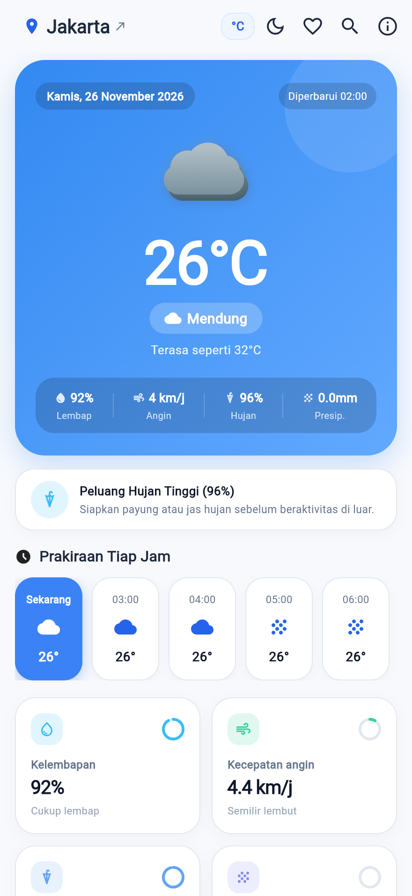
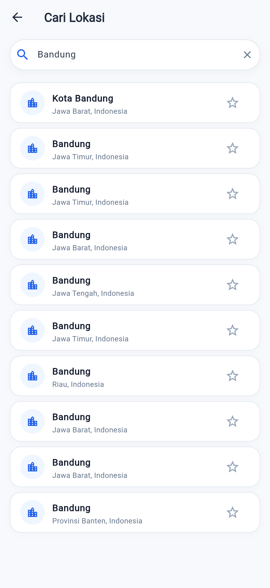
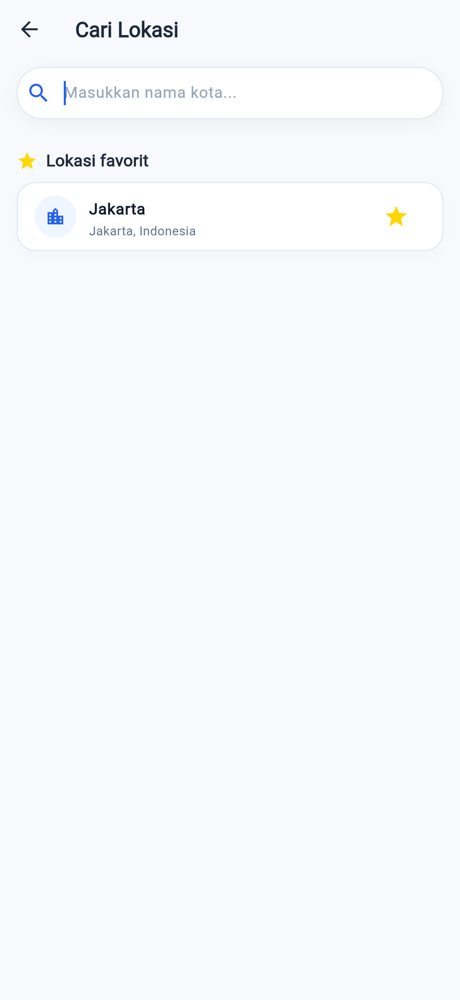
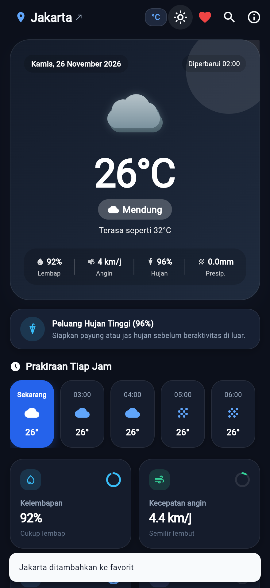
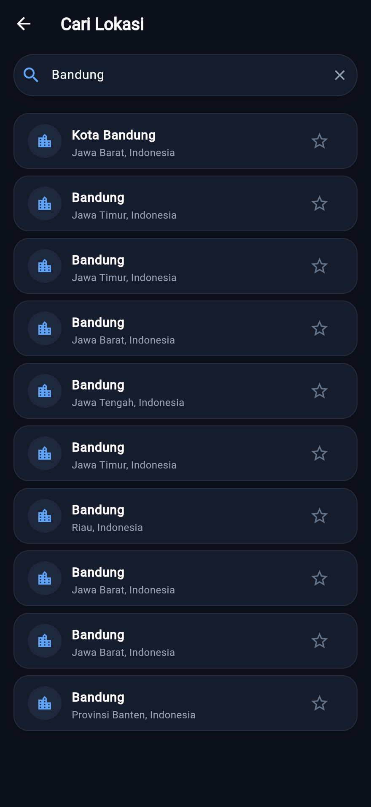

# Aplikasi Cuaca Flutter (Responsi Flutter)

Aplikasi cuaca berbasis **Flutter + Dart** yang mengambil data dari **Open-Meteo REST API**
(Forecast API + Geocoding API), menggunakan arsitektur **MVVM**, state management **Provider**,
dan penyimpanan lokal **SharedPreferences**.

> **Nama / NIM:** Salma Faizatul Jannah / H1D024066

## Screenshot Aplikasi

### Light Mode

| Home / Weather Screen | Search / Location Screen | Favorit & Riwayat |
|:---:|:---:|:---:|
|  |  |  |

### Dark Mode

| Home / Weather Screen | Search / Location Screen | Favorit & Riwayat |
|:---:|:---:|:---:|
|  |  |  |

## Fitur

- Cuaca terkini: nama kota, kondisi cuaca (ikon + teks), suhu, suhu terasa.
- **Hourly Forecast**: Perkiraan cuaca per jam (24 jam) dengan scroll horizontal dan indikator waktu aktif.
- Informasi parameter cuaca lengkap: Kelembapan, kecepatan angin, peluang hujan, curah hujan, tekanan udara, indeks UV, dan meteran busur visual (*arc visual indicators*).
- Perkiraan cuaca 7 hari ke depan dengan rentang suhu min/maks dan peluang hujan.
- Pencarian kota ke Geocoding API (dengan debounce 500 ms).
- Simpan lokasi **favorit** dan **riwayat pencarian** (SharedPreferences) - tampil kembali saat aplikasi dibuka.
- Lokasi terakhir yang dilihat otomatis dimuat saat aplikasi dibuka.
- Penanganan state **loading**, **data kosong**, dan **error** (tombol "Coba lagi").
- Tarik ke bawah untuk memuat ulang (pull-to-refresh).
- Material 3, Theme terang/gelap otomatis & manual dengan tombol toggle (tersimpan di SharedPreferences).
- Pilihan satuan suhu (°C / °F) yang dapat diubah secara instan dan tersimpan di SharedPreferences.
- Dialog informasi identitas pengembang & aplikasi (About Dialog).
- Ikon aplikasi kustom modern di semua platform (Android, iOS, Web).
- Tampilan responsif (HP & layar lebar) via LayoutBuilder & ConstrainedBox.

## Struktur Proyek (MVVM)

```
lib/
├── main.dart                         # entry point + MultiProvider + MaterialApp
├── core/
│   ├── app_theme.dart                # Theme & Typography (Material 3)
│   └── weather_code.dart             # weather_code WMO -> teks + ikon
├── models/                           # MODEL (data class + parsing JSON)
│   ├── location_model.dart
│   └── weather_model.dart            # CurrentWeather, DailyForecast, WeatherModel
├── services/                         # sumber data
│   ├── weather_api_service.dart      # HTTP GET ke Open-Meteo
│   ├── local_storage_service.dart    # SharedPreferences
│   └── api_exception.dart
├── repositories/
│   └── weather_repository.dart       # penghubung ViewModel <-> services
├── viewmodels/                       # VIEWMODEL (ChangeNotifier)
│   ├── view_state.dart               # initial/loading/success/empty/error
│   ├── weather_view_model.dart       # state Home Screen
│   └── search_view_model.dart        # state Search Screen, favorit, riwayat
└── views/                            # VIEW (UI)
    ├── home_screen.dart              # Screen 1
    ├── search_screen.dart            # Screen 2
    └── widgets/message_view.dart
```

**Alur MVVM:** `View` (widget) -> memanggil method `ViewModel` -> `ViewModel` meminta data ke
`Repository` -> `Repository` memanggil `ApiService` / `LocalStorageService` -> hasil menjadi `Model`
-> `ViewModel` memanggil `notifyListeners()` -> `View` rebuild otomatis lewat `context.watch`.

## Implementasi API

| Kebutuhan | Endpoint (HTTP GET) |
|---|---|
| Cari kota | `https://geocoding-api.open-meteo.com/v1/search?name=<kota>&count=10&language=id` |
| Cuaca | `https://api.open-meteo.com/v1/forecast?latitude=..&longitude=..&current=temperature_2m,relative_humidity_2m,apparent_temperature,precipitation,weather_code,wind_speed_10m&daily=weather_code,temperature_2m_max,temperature_2m_min,precipitation_probability_max&timezone=auto&forecast_days=7` |

Respons JSON diubah menjadi model Dart (`LocationModel`, `WeatherModel`) lewat `fromJson`.
Semua data cuaca berasal dari API (tidak ada data statis).

## Cara Menjalankan

```bash
# 1. (sekali saja) buat folder platform android/ios/web
flutter create --project-name weather_app --org com.example --platforms=android,ios,web .

# 2. ambil dependency
flutter pub get

# 3. jalankan (emulator/HP tersambung)
flutter run

# 4. (opsional) analisis & test
flutter analyze
flutter test
```

**Android release:** tambahkan izin internet di `android/app/src/main/AndroidManifest.xml`
(di atas tag `<application>`):

```xml
<uses-permission android:name="android.permission.INTERNET"/>
```

(Mode debug sudah otomatis memiliki izin ini.)

## Dependency

| Package | Fungsi |
|---|---|
| `http` | HTTP GET ke REST API |
| `provider` | State management (ChangeNotifier) |
| `shared_preferences` | Local storage (favorit, riwayat, lokasi terakhir) |
| `intl` | Format tanggal Bahasa Indonesia |

## Video Penjelasan


